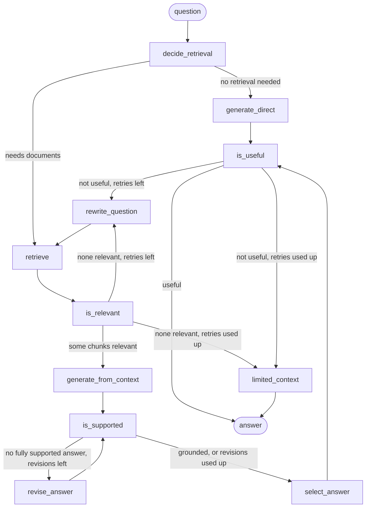

# Self-RAG

A retrieval-augmented generation system that **decides whether to retrieve, grades what it
retrieves, checks its own answer, and retries when the answer is weak**.

It uses LangGraph for orchestration, Groq (`openai/gpt-oss-20b`) as the LLM, Ollama
(`mxbai-embed-large`) for embeddings, and Chroma as the local vector store. All the logic is in
one file, `self_rag.py`; `app.py` is a thin Streamlit UI on top of it.

## What is Self-RAG?

Plain RAG always retrieves and always trusts what it gets. Self-RAG adds *reflection*: the model
critiques its own steps with small structured judgements, modelled on the paper's reflection tokens.

| Check | Question it answers | Node |
|-------|---------------------|------|
| **Retrieve** | Does this question need the documents at all? | `decide_retrieval` |
| **ISREL** | Is this retrieved chunk relevant to the question? | `is_relevant` |
| **ISSUP** | Is the generated answer grounded in its chunk? | `is_supported` |
| **ISUSE** | Does the answer actually address the question? | `is_useful` |

Every judgement is a Pydantic schema returned through Groq structured output (`json_schema`
mode, with a tool-calling fallback). Nothing is parsed from free text.

## Architecture



How a question flows:

1. **decide_retrieval** picks the document path or a direct general-knowledge answer.
2. **retrieve** fetches the top 4 chunks from Chroma. After a rewrite it uses the rewritten query.
3. **is_relevant** grades each chunk and keeps the relevant ones.
4. **generate_from_context** writes one candidate answer per relevant chunk, using only that chunk.
5. **is_supported** grades each candidate against its own chunk as fully, partially or not supported,
   and lists the unsupported claims.
6. **revise_answer** runs when no candidate is fully supported. It rewrites the weak candidates to
   keep only supported content, for at most `MAX_REVISIONS = 2` rounds.
7. **select_answer** picks the best-supported candidate. Its chunk becomes the cited source.
8. **is_useful** checks the answer addresses the question. If not, **rewrite_question** produces a
   better retrieval query and the loop retries, at most `MAX_RETRIES = 2` times.
9. **limited_context** is the honest fallback. It returns the best answer found with a
   "limited context" note, or a plain "could not find it in the documents" message.

Retries and revisions are both bounded, so the graph always terminates.

## Setup

Requires [uv](https://docs.astral.sh/uv/), [Ollama](https://ollama.com/) and a
[Groq](https://console.groq.com/) API key.

```bash
# 1. Embedding model (must be installed locally)
ollama pull mxbai-embed-large

# 2. Secrets
cp .env.example .env        # then set GROQ_API_KEY in .env

# 3. Put PDF / .txt / .md files in documents/, then build the index
uv run self_rag.py ingest

# 4. Ask questions
uv run self_rag.py ask "How does a TCP server accept client connections?"

# 5. Or use the web UI
uv run streamlit run app.py
```

Other commands:

```bash
uv run self_rag.py ingest --force      # rebuild the index from scratch
uv run self_rag.py -v ask "..."        # log every graph step
uv run self_rag.py --eval              # run four sample questions and show their paths
```

Ingest is idempotent: it skips if `./chroma_db` already has vectors. Chunks are 1000 characters with
200 overlap (`CHUNK_SIZE`, `CHUNK_OVERLAP`). Queries, but not documents, are prefixed with
`Represent this sentence for searching relevant passages: `, as `mxbai-embed-large` expects.

### Configuration

| Setting | Where | Default |
|---------|-------|---------|
| `GROQ_API_KEY` | `.env` | required |
| `GROQ_MODEL` | `.env` | `openai/gpt-oss-20b` |
| `TOP_K`, `MAX_REVISIONS`, `MAX_RETRIES`, `MAX_CONCURRENCY` | constants in `self_rag.py` | 4, 2, 2, 2 |

### Groq free-tier notes

The free tier allows about 8,000 tokens per minute for this model, and one full Self-RAG pass makes
roughly a dozen LLM calls. So a question can take 20 to 40 seconds while the client waits out
429 responses (it retries with backoff, up to `GROQ_MAX_RETRIES`). Reasoning effort is set to
`low` and batches run with a concurrency cap of 2 to stay inside the limit.

## Sample questions

The bundled `documents/` cover databases, network programming and software practices.

| Question | What to expect |
|----------|----------------|
| `What is the capital of France?` | No retrieval, direct answer |
| `How does a TCP server accept client connections?` | Retrieval, supported, useful, no retries |
| `What is a B-tree and why do databases use it?` | Retrieval, answer cites a page |
| `why write the diary before touching the real data in databases` | Poorly phrased: query rewrite loop |
| `What do the documents say about Kubernetes operators for TCP load balancing?` | Honest "could not find it" answer |

## Project layout

```
self_rag.py   config, embeddings & store, ingest, state, nodes, routing, graph, eval, CLI
app.py        Streamlit UI with a "How Self-RAG answered this" trace viewer
documents/    source files
chroma_db/    local vector store (gitignored, created by ingest)
```
